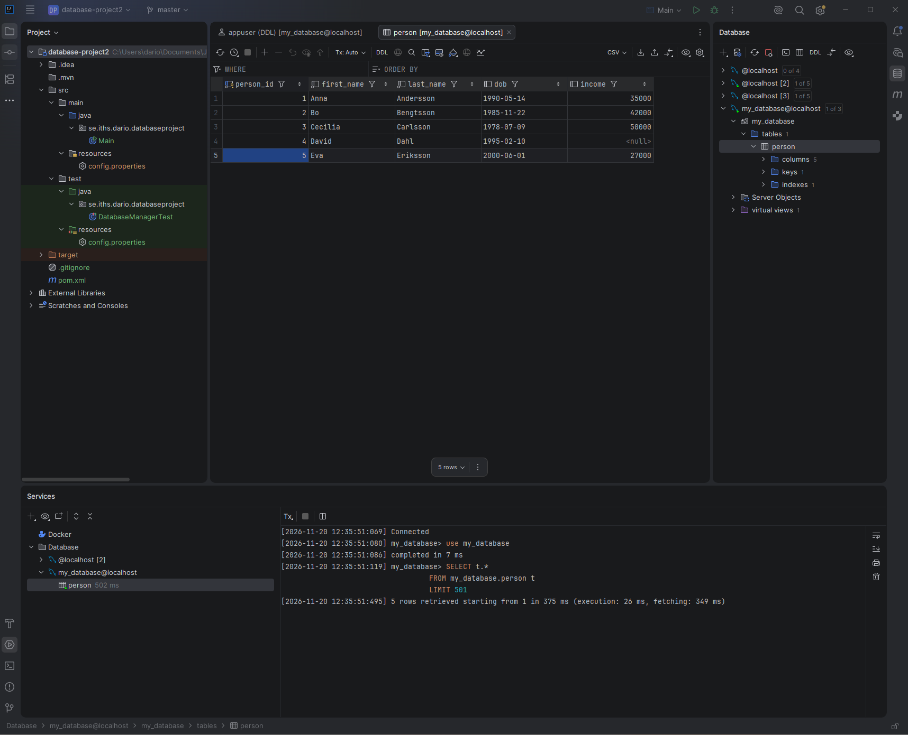
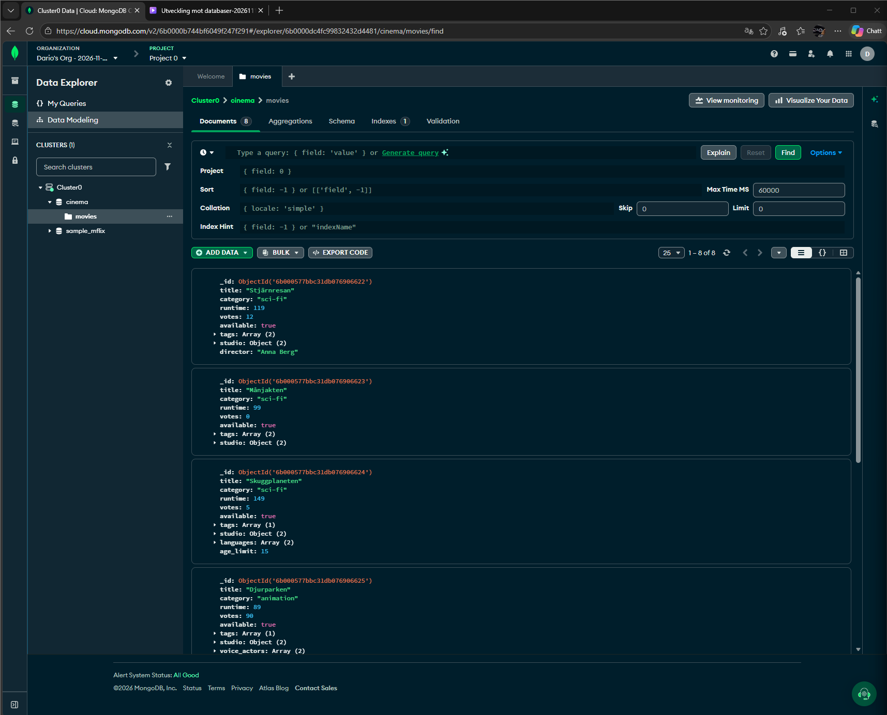
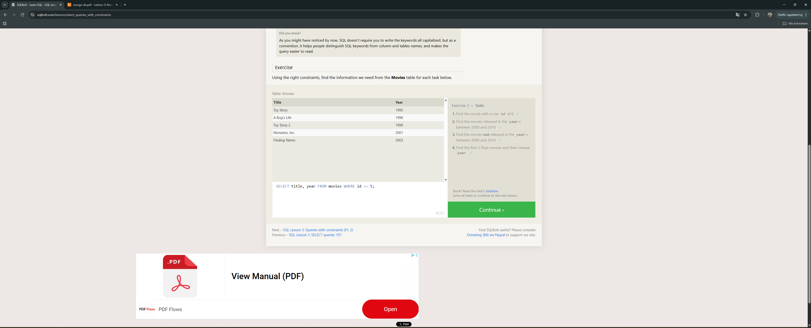

# Labb 1

# MySQL

Skärmdump som visar database explorer i IntelliJ med skapad person-tabell med data:

NOT: Ni ska även ha skapat en user som bara har access till databasen my_database, ingen bild krävs

# MongoDB

Skärmdump av databas på MongoDB Atlas med skapad movie-collection med data:

# SQL

Skärmdump som visar att ni klarat av första två sidorna på sqlbolt.com:s interaktiva tutorial

# Frågor som ni ska svara på (G-nivå)

Besvara frågorna med egna ord. Ge gärna exempel.

## Databaser och verktyg

1. Vad är en databas, och vad kan den användas till?

   En databas är en strukturerad samling av information som lagras digitalt så att data enkelt kan sparas, sökas, uppdateras och raderas.

2. Vad används språket SQL till?

SQL används för att styra en relationsdatabas och ställa frågor till den.

## Tabeller och relationer

3. Vad är en tabell, en rad och en kolumn?

   En tabell är en samlad lista med data om en viss sak, till exempel en tabell för kunder. 
   I den tabellen motsvarar varje rad en enskild post, som en specifik kund, 
   medan varje kolumn beskriver en viss egenskap hos datan, exempelvis förnamn eller ålder.

4. Vad är en primärnyckel, och varför behövs den?

   En primärnyckel är ett unikt ID-nummer som varje rad har och den behövs för att man säkert ska kunna skilja två rader åt.

5. Vad är en främmande nyckel?

   En främmande nyckel är en kolumn i en tabell som pekar på primärnyckeln i en annan tabell för att länka dem samman.

6. Varför är det bra att lagra kunduppgifter och köp i olika tabeller?

   För att man ska slippa upprepa kundens namn och adress vid varje nytt köp det sparar plats och minskar risken för fel.

## NoSQL

7. Vad menas med NoSQL, och hur kan information organiseras i en sådan databas?

   NoSQL är databaser som inte använder vanliga tabeller. 
   Istället sparas informationen som dokument, nyckel och värde, kolumner eller grafer.

8. Ge ett exempel på när en NoSQL-databas kan vara lämplig och förklara varför.
   
   Ett bra exempel är en fotbollsapp som visar livestatistik under matcher. 
   En NoSQL-databas är lämplig här eftersom olika spelare och händelser har helt olika statistik, en målvakt har räddningar, 
   en anfallare har skott på mål och ett byte har helt annan information. 
   Istället för krångliga tabeller kan varje händelse sparas precis som den är, 
   vilket gör att appen klarar av att uppdatera resultaten blixtsnabbt för miljontals fans samtidigt.
   
   

## SQL – hämta data från tabellen person

Skriv en SQL-fråga som svar på varje uppgift.

9. Hämta alla kolumner för alla personer i tabellen.

   SELECT * FROM person;

10. Hämta endast förnamn och efternamn för alla personer.

    SELECT fornamn, efternamn FROM person;

11. Hämta förnamn, efternamn och inkomst för personer med en inkomst över 30 000.

    SELECT fornamn, efternamn, inkomst
    FROM person
    WHERE inkomst > 30000;

12. Hämta alla personer födda före den 1 januari 1990.

    SELECT *
    FROM person
    WHERE fodelsedatum < '1990-01-01';

13. Hämta förnamn, efternamn och inkomst, sorterat efter inkomst från högst till lägst.

    SELECT fornamn, efternamn, inkomst
    FROM person
    ORDER BY inkomst DESC;

14. Räkna hur många personer som finns i tabellen.

    SELECT COUNT(*) FROM person;

# VG-nivå

Dessa frågor ska besvaras med ett längre svar, minst en halv A4-sida:

1. En banköverföring avbryts efter att pengarna dragits från det första kontot.
   Vad kan konsekvensen bli, och hur kan en transaktion hjälpa?

2. Välj ett enkelt system, antingen en webbutik eller en chatt.
   Resonera om när en relationsdatabas respektive en NoSQL-databas
   kan vara lämplig. Motivera med hur informationen ska lagras och användas.